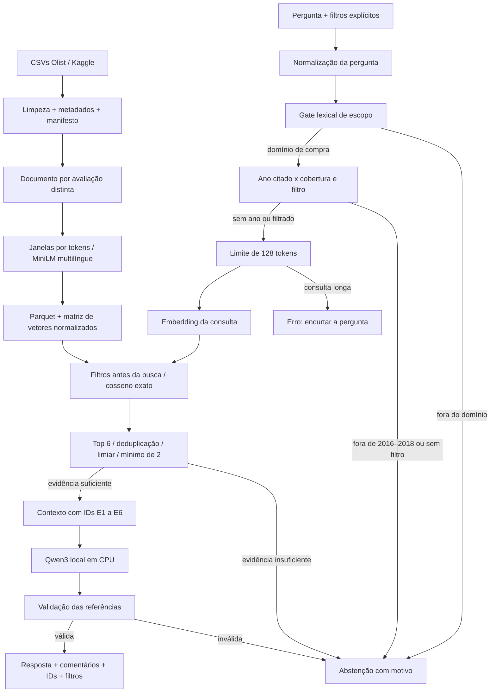

# Voz do Cliente · Olist

**André Mohallem Ferraz · FIAP / Pós Tech · Tech Challenge Fase 4 · Trabalho individual**

Uma aplicação RAG local para investigar avaliações históricas do e-commerce brasileiro.
A pergunta recupera comentários por significado; um modelo de linguagem sintetiza os
relatos e cita as avaliações utilizadas. A interface permite conferir os textos, IDs,
notas e categorias de cada evidência. Não há chave nem cobrança de API.

O enunciado desta fase exige **Voice of Customer Intelligence com RAG sobre a base
Olist**, um problema diferente da classificação de alfabetização da Fase 3. Reaproveitamos
a disciplina de organização, testes e reprodução. Nesta entrega, o código-fonte integra
o repositório e o pacote de avaliação, com acesso direto a cada etapa.

## Entregáveis do enunciado

| Item exigido no repositório | Onde está |
| --- | --- |
| Código-fonte da solução | [`src/voc/`](src/voc), [`app.py`](app.py), [`streamlit_app.py`](streamlit_app.py), testes em [`tests/`](tests) |
| Instruções de instalação e execução | [Executar](#executar) e [Consultar pela linha de comando](#consultar-pela-linha-de-comando) |
| README explicando o projeto | Este arquivo |
| Descrição da arquitetura | [Arquitetura](#arquitetura) e [docs/ARCHITECTURE.md](docs/ARCHITECTURE.md) |
| Tecnologias e bibliotecas | [Tecnologias e bibliotecas](#tecnologias-e-bibliotecas) |
| Estratégia do pipeline RAG | [Preparação da base e pipeline RAG](#preparação-da-base-e-pipeline-rag) |
| Preparação da base | [Preparação da base e pipeline RAG](#preparação-da-base-e-pipeline-rag), itens 1–5 |
| Justificativa das decisões técnicas | [Principais decisões técnicas](#principais-decisões-técnicas) |
| Exemplos de perguntas e respostas | [Exemplos de perguntas e respostas](#exemplos-de-perguntas-e-respostas) |
| Informações para reproduzir | [Verificar e reproduzir](#verificar-e-reproduzir) |

O mapa completo, incluindo os itens do vídeo, está em [docs/REQUIREMENTS.md](docs/REQUIREMENTS.md).

## Executar

Ambiente de referência: Linux / WSL2, Python **3.12**, CPU. Instale o
[uv](https://docs.astral.sh/uv/getting-started/installation/). Execute na raiz deste projeto:

```bash
uv sync --frozen
uv run python app.py download
uv run python app.py models
uv run python app.py prepare
uv run python app.py index
uv run streamlit run streamlit_app.py
```

Abra `http://localhost:8501`. O primeiro preparo baixa a base pública (~43 MB compactados),
as bibliotecas CPU e os pesos dos dois modelos (~4,3 GB). Reserve aproximadamente 8 GB em
disco, 12 GB de RAM e alguns minutos para gerar o índice em CPU. Depois do preparo, consultas
e geração funcionam localmente sem internet. O tempo depende do hardware.

Se o Kaggle exigir autenticação ou bloquear o download automatizado, baixe o ZIP na
[página oficial da Olist](https://www.kaggle.com/datasets/olistbr/brazilian-ecommerce) e use:

```bash
uv run python app.py download --zip /caminho/brazilian-ecommerce.zip
```

**Não há dados simulados no pipeline.** Os testes automatizados usam pequenas fixtures
declaradamente artificiais; o índice e os exemplos de demonstração utilizam a base real.
Não são necessários dados nem modelos para executar os testes unitários.

## Consultar pela linha de comando

```bash
uv run python app.py ask "O que os clientes relatam sobre atrasos na entrega?"
uv run python app.py ask "Há relatos de produtos quebrados?" --max-score 2
uv run python app.py ask "O que os clientes elogiam?" --min-score 4 --category moveis_decoracao
uv run python app.py ask "Quais relatos mencionam atraso?" --late-only --retrieve-only
uv run python app.py ask "O que dizem sobre a entrega?" --start-date 2018-01-01 --end-date 2018-06-30 --output reports/runs/consulta.json
```

`--retrieve-only` executa somente a busca e identifica essa condição explicitamente.
O modo padrão executa o **LLM real**. Não se substitui a geração por uma resposta pronta.
Se faltarem evidências ou a saída não tiver referências válidas, o sistema se abstém e
permite inspecionar os comentários. Uma falha ao carregar um modelo é um erro operacional,
não é disfarçada como resposta sem evidências.

Os filtros são explícitos: escrever “nota baixa” na pergunta não ativa um filtro de nota.
Selecione o intervalo na interface ou use `--max-score 2`. O mesmo vale para anos: se a
pergunta cita um ano fora da base (2016–2018), o sistema informa que não há avaliações do
período; se o ano está dentro da base, pede o filtro de período antes de responder. Datas filtram a **compra**;
a data exibida na evidência é a **criação da avaliação**. “Entrega atrasada” nos metadados
significa entrega registrada em dia posterior à estimativa, sem inferir a causa.

## Arquitetura

Dois fluxos: a preparação transforma os CSVs da Olist em documentos, trechos e vetores; a
consulta aplica recusas antes da busca, recupera evidências e só então gera a resposta.



Camadas do código: `domain` (entidades, regras de evidência e prompt, sem dependências
externas), `infrastructure` (CSVs, embeddings, índice e LLM), `usecase` (orquestração do
RAG e avaliação) e `views` (CLI). Detalhes em [docs/ARCHITECTURE.md](docs/ARCHITECTURE.md).

## Tecnologias e bibliotecas

| Tecnologia | Versão | Uso |
| --- | --- | --- |
| Python + [uv](https://docs.astral.sh/uv/) | 3.12, `uv.lock` | Ambiente e dependências congeladas |
| [sentence-transformers](https://www.sbert.net/) | 5.1.1 | Embeddings com `paraphrase-multilingual-MiniLM-L12-v2` (384 dimensões) |
| [Transformers](https://huggingface.co/docs/transformers) + [PyTorch](https://pytorch.org/) CPU | 4.57.1 / 2.9.0 | Geração local com `Qwen/Qwen3-1.7B` |
| NumPy | 2.3.3 | Matriz de vetores normalizados e busca por cosseno exato |
| pandas + PyArrow | 2.3.2 / 21.0.0 | Limpeza, junções e armazenamento em Parquet |
| [Streamlit](https://streamlit.io/) | 1.50.0 | Interface de investigação |
| requests | 2.32.5 | Download da base pública |
| pytest + Ruff | 8.4.2 / 0.13.1 | Testes, lint e formatação; executados no CI (GitHub Actions) |

Modelos e revisões fixadas: [config/models.json](config/models.json). Não há chave de API,
serviço pago nem banco vetorial externo.

## Principais decisões técnicas

| Decisão | Justificativa | Custo ou limite |
| --- | --- | --- |
| Um documento por avaliação distinta, título + mensagem | Preserva contexto e rastreabilidade até `review_id` e `order_id` | Comentários curtos limitam a síntese |
| Embeddings multilíngues em CPU | Busca por significado em português, sem GPU nem API | Pode recuperar analogias irrelevantes |
| Cosseno exato + MMR | ~42 mil documentos cabem em memória; scores auditáveis; MMR reduz repetição | Custo linear por pergunta |
| Filtros explícitos de metadados antes do ranking | Nota, período, categoria e atraso não são “inferidos” do texto | O usuário precisa escolher o filtro |
| Mínimo de 2 evidências com cosseno ≥ 0,50 | Evita síntese sobre relato isolado ou sem relação | Pode recusar pergunta rara mas legítima |
| Recusa de agregações, períodos fora da base e consultas longas | Top-k não mede frequência; a base cobre 2016–2018; o encoder lê 128 tokens | Análise quantitativa exige módulo próprio |
| Qwen3-1.7B local com validação das referências | Sem envio de comentários a terceiros; cada tópico cita [E#] existentes | 10–25 s por resposta; checagem de formato, não de verdade |

Alternativas, comparação de geradores e evidências: [docs/ARCHITECTURE.md](docs/ARCHITECTURE.md).

## Preparação da base e pipeline RAG

1. Baixa e registra os hashes dos CSVs de avaliações, pedidos, itens e produtos.
2. Combina título e mensagem, preserva negações e acentos e mascara padrões de contatos.
3. Exclui textos vazios, mantém avaliações distintas com o mesmo `review_id` e agrega
   categorias por pedido antes da junção, evitando multiplicação de documentos.
4. Divide apenas textos longos em janelas de até 120 tokens com sobreposição de 20.
5. Gera embeddings multilíngues normalizados de 384 dimensões e armazena índice NumPy + Parquet.
6. Confere um vocabulário conservador de experiência de compra, pagamento e pós-venda,
   recusa anos fora da cobertura e consultas acima de 128 tokens; aplica os filtros antes
   de calcular a similaridade de cosseno exata e diversifica o
   contexto por MMR entre os 100 candidatos mais próximos, com peso de relevância 0,7.
7. Recupera seis avaliações, evita documentos e textos repetidos no mesmo contexto e exige
   ao menos duas evidências com similaridade ≥ 0,50 antes da geração.
8. Envia somente os trechos e suas referências ao Qwen3 local, que agrupa os relatos por
   tema. Exige referências existentes em todos os tópicos e recusa rótulos inventados,
   alegações de frequência e saídas fora do formato.

Modelo de busca: [paraphrase-multilingual-MiniLM-L12-v2](https://huggingface.co/sentence-transformers/paraphrase-multilingual-MiniLM-L12-v2).
Gerador: [Qwen3-1.7B](https://huggingface.co/Qwen/Qwen3-1.7B), sem modo de pensamento, geração
greedy, limite de 384 tokens; cerca de 10–25 s por resposta em CPU. Substituiu o Qwen3-0.6B
após a revisão de 22/11/2026, que mostrou o modelo menor copiando comentários e o marcador
do formato pedido ([comparação](docs/ARCHITECTURE.md#escolha-do-gerador)). Revisões exatas e parâmetros em [config/models.json](config/models.json).
Ambos são modelos pré-treinados; não há ajuste fino neste projeto.

## Exemplos de perguntas e respostas

Respostas reais do Qwen3-1.7B na avaliação de 22/11/2026, copiadas sem edição dos
relatórios. Cada tabela mostra as três primeiras das seis evidências; o JSON indicado
traz todas, com textos completos, `order_id`, datas e similaridades. As três últimas
perguntas mostram a abstenção: período fora da base, fora do domínio e agregação.

**O que os clientes relatam sobre problemas relacionados à entrega?** (sem filtros) · status `answered`

> - Atraso na entrega [E1]
> - Erro na entrega, produto incompleto [E2]
> - Problema grave com a entrega [E3]
> - Processo de entrega demorado [E4]
> - Produto entregue com problemas [E5]
> - Correios não cumpriram o prometido [E6]

| Ref. | Nota | Trecho do comentário | review_id |
| --- | ---: | --- | --- |
| E1 | 1 | Atraso na entrega | `44dba35181b5…` |
| E2 | 1 | erro na entrega. a entrega nao chegou correta completa | `249f0e6fef00…` |
| E3 | 1 | TERRIVEL ESTE PROBLEMA DA ENTREGA | `452cfaa876b9…` |

<sub>Fonte: `reports/evaluation_enunciado_rag.json`, caso `enun-delivery`.</sub>

**Quais avaliações sustentam a conclusão de que existem problemas recorrentes relacionados ao prazo de entrega?** (sem filtros) · status `answered`

> - O status da entrega é ruim, sempre desatualizado [E1]
> - Prazos variáveis e entregas antecipadas [E1]
> - Muita demora na entrega e rastreamento [E3][E4]
> - Atraso na entrega prejudicou a obra [E6]

| Ref. | Nota | Trecho do comentário | review_id |
| --- | ---: | --- | --- |
| E1 | 4 | O status da entrega é ruim, sempre desatualizado, mostra que teve erro na entrega, mudam o prazo e no fim e… | `18fd8314a11f…` |
| E2 | 4 | recomendado. produto entregue no prazo ainda em avaliação | `cef052586f5b…` |
| E3 | 2 | Muita demora | `0cc13e5aa926…` |

<sub>Fonte: `reports/evaluation_enunciado_rag.json`, caso `enun-deadline-evidence`.</sub>

**Quais relatos mencionam produtos que chegaram quebrados?** (sem filtros) · status `answered`

> - Produto veio quebrado [E1][E6]
> - Defeitos e quebra em produtos [E3][E4]
> - Problemas de embalagem e condições de entrega [E5]
> - Partes quebradas dentro da caixa [E6]

| Ref. | Nota | Trecho do comentário | review_id |
| --- | ---: | --- | --- |
| E1 | 2 | Produto veio quebrado | `03a673dc9858…` |
| E2 | 1 | Produto diferente do oferecido, e cheio de defeitos | `893659b7a097…` |
| E3 | 1 | Produto que sinais de uso , manchado , marcado e quebrado | `18fe9f34aace…` |

<sub>Fonte: `reports/evaluation_dev_rag.json`, caso `dev-damage`.</sub>

**O que os compradores elogiam na qualidade dos produtos?** (nota mínima 4) · status `answered`

> - Produto de qualidade! Compromisso com o cliente e qualidade no produto resumem essa compra [E1]
> - Recomendam a compra por pontualidade e qualidade dos produtos [E2]
> - Vendedor excelente, produto de qualidade e processo de compra excelentes [E3]
> - Respeito, consideração, agilidade e qualidade dos produtos destacados [E4]
> - Produto conforme descrição, satisfeita com a compra [E5]
> - Pontualidade e qualidade dos produtos estão de parabéns [E6]

| Ref. | Nota | Trecho do comentário | review_id |
| --- | ---: | --- | --- |
| E1 | 5 | Produto de qualidade!. Compromisso com o cliente e qualidade no produto resumem essa compra | `76df0bd8c9d6…` |
| E2 | 5 | Recomendo a compra nessa loja, primam pela pontualidade e qualidade dos produtos | `38ff9e5da94f…` |
| E3 | 5 | Ótimo vendedor!. Produto de qualidade, excelência no processo de compra | `e2b4d5970fef…` |

<sub>Fonte: `reports/evaluation_test_rag.json`, caso `test-quality`.</sub>

**O que os clientes relataram sobre atrasos na entrega em 2025?** (sem filtros) · status `period_out_of_coverage`

> A base contém compras de 2016 a 2018. Não há avaliações de 2025 para sustentar uma resposta.

<sub>Fonte: `reports/evaluation_regressao_rag.json`, caso `reg-future-2025`.</sub>

**Explique a teoria da relatividade geral e a curvatura do espaço-tempo.** (sem filtros) · status `out_of_scope`

> Esta base permite investigar relatos de experiências de compra e atendimento. A pergunta está fora desse escopo.

<sub>Fonte: `reports/evaluation_test_rag.json`, caso `test-physics`.</sub>

**Qual o percentual de pedidos com reclamação de atraso?** (sem filtros) · status `unsupported_aggregate`

> Esta busca não calcula totais ou percentuais do corpus. Reformule para explorar os relatos e suas evidências.

<sub>Fonte: `reports/evaluation_test_rag.json`, caso `test-aggregate`.</sub>

## Verificar e reproduzir

```bash
uv run pytest -q
uv run ruff check .
uv run ruff format --check .
uv run python app.py evaluate --split dev
uv run python app.py evaluate --split test
uv run python app.py evaluate --split test --generate
uv run python app.py evaluate --split enunciado --generate
uv run python app.py evaluate --split regressao --generate
uv run python app.py reproduce
```

Quem já tinha o Qwen3-0.6B baixado deve executar `uv run python app.py models` uma vez:
o marcador `models/<tipo>/source.json` impede carregar pesos diferentes de
`config/models.json` e indica esse comando.

A avaliação separa o gate de evidências da geração. O conjunto autoral é pequeno e inclui
perguntas do domínio, fora do domínio, filtros vazios e uma pergunta quantitativa que o
top-k não permite responder. O split `enunciado` reúne as perguntas de exemplo do
enunciado; `regressao`, os casos da validação de 17/11/2026, escritos depois de conhecidas
as falhas e, portanto, não independentes. Consulte o [protocolo](evaluation/PROTOCOL.md) antes de
interpretar os resultados. Referências válidas são uma checagem de formato, não prova de
veracidade. Os exemplos e métricas efetivamente executados ficam em `reports/`.

O comando `reproduce` reconstrói a preparação, chunks e embeddings em uma pasta
temporária, compara os três arquivos por SHA-256 e confere IDs e scores de uma busca.
Os pesos locais são reutilizados e o projeto original é preservado.
Também é possível executar `download`, `prepare` e `index` em uma nova cópia do código.
Compare `source_manifest.json`, `data_quality.json` e `index_manifest.json`. O índice
verifica os hashes de documentos, chunks e vetores ao abrir. Pesos fixos e dependências
congeladas reduzem variações; versões de CPU/BLAS podem alterar scores nas últimas casas.

## Organização e entregáveis

```text
app.py / streamlit_app.py    Entradas CLI e interface
src/voc/domain/              Entidades, política de evidências e prompt
src/voc/infrastructure/      CSVs, armazenamento, embeddings, índice e LLM
src/voc/usecase/             RAG e avaliação
src/voc/views/               CLI
config/                     Modelos e parâmetros congelados
evaluation/                 Perguntas, protocolo e julgamentos de relevância
tests/                      Integridade, metadados, filtros e abstenção
reports/                    Manifestos, resultados executados, histórico do 0.6B e comparação de geradores
docs/                       Arquitetura, decisões, mapa do enunciado e roteiro
data/raw / data/processed/   Dados locais, fora do Git
models / artifacts/         Pesos e índice locais, fora do Git
```

- [Arquitetura e decisões](docs/ARCHITECTURE.md)
- [Requisitos e localização do código](docs/REQUIREMENTS.md)
- [Roteiro do vídeo de até sete minutos](docs/VIDEO.md)
- [Fontes e licenças](THIRD_PARTY.md)

O vídeo deve demonstrar a aplicação e ser gravado pelo autor antes da submissão.
Este repositório fornece o código e as instruções; não constitui o envio no portal da FIAP.

## Limites da interpretação

O corpus representa avaliações de 2016–2018, com viés de quem escreveu comentários.
Uma seleção por similaridade não mede os problemas mais frequentes em toda a base.
Por isso, a aplicação descreve os relatos recuperados e recusa percentuais ou totais
solicitados na pergunta. Não há inferência causal, análise de tendência atual nem previsão.

O gate lexical pode recusar perguntas válidas que não explicitem seu tema; reformule
incluindo o contexto de compra, avaliação, produto, entrega ou atendimento.
O limiar de similaridade é heurístico e pode falhar diante de perguntas fora do escopo que
compartilhem palavras com os comentários. O LLM é pequeno e pode produzir sínteses incorretas
mesmo citando IDs existentes; perguntas sobre “frequência” recebem relatos agrupados, não
contagens. A conferência das evidências continua necessária.
Os comentários são delimitados como dados não confiáveis no prompt; isso reduz, mas não
elimina, ataques por instruções no texto. O mascaramento por regex não garante anonimização
completa. Não se importam nomes ou cadastros de clientes da tabela de consumidores.
