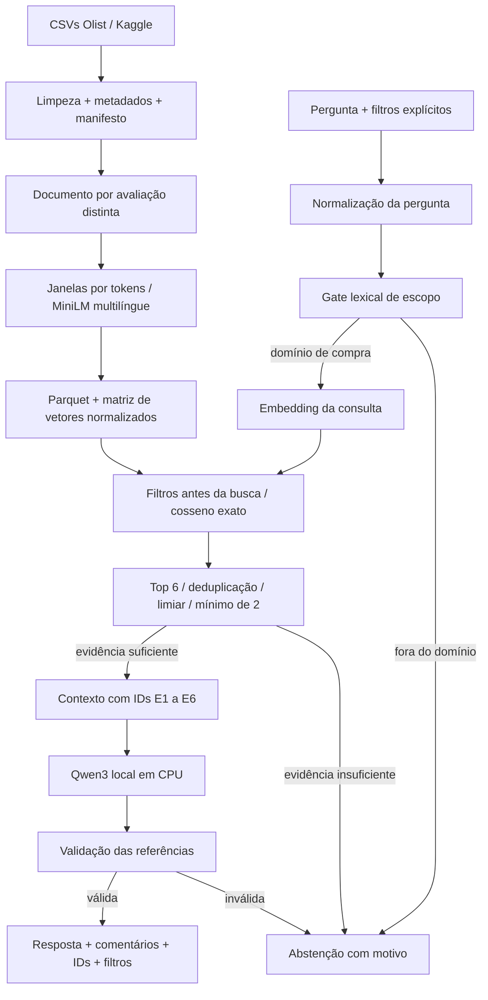

# Arquitetura e decisões técnicas

## Documentos e metadados

A unidade é uma avaliação distinta: `review_id` não é assumido único. O `document_id`
é um hash determinístico de avaliação, pedido, nota, data e texto preparado. Linhas
idênticas são removidas; comentários semelhantes de pedidos diferentes continuam no
corpus. Durante a recuperação, textos exatamente iguais após `casefold` entram uma
única vez no contexto, evitando seis evidências compostas pelo mesmo “muito bom”.

Título e mensagem são complementares. Uma avaliação apenas com título pode ser útil;
uma nota sem texto não pode sustentar um insight textual. Ausência não é preenchida com
texto inventado. Não há stemming, tradução ou remoção de stopwords: negações e nuances
devem chegar aos modelos. HTML, espaços, entidades e contatos padronizados são tratados.

Categorias dos itens são agregadas por pedido antes do `merge`, validado como
`many_to_one`. Pedidos com mais de uma categoria mantêm todas; não se atribui a reclamação
a um produto específico sem evidência no texto. Falta de entrega registrada permanece
desconhecida, sem virar entrega pontual. Datas inválidas são reportadas.

## Busca semântica e índice

MiniLM multilíngue produz embeddings densos de 384 dimensões. A escolha atende ao
português e mantém a execução em CPU viável. A janela nativa é curta, então os textos
são divididos por offsets do tokenizer, em até 120 tokens com 20 de sobreposição, sem
cortar um documento silenciosamente. A consulta é normalizada e tem apenas sua moldura
interrogativa inicial removida. Para perguntas amplas sobre os principais problemas sem
tema específico, uma regra explícita acrescenta os temas compra, produto, entrega e
atendimento. Não há expansão por LLM nem tradução oculta.

Uma matriz NumPy `float32` armazena vetores normalizados. Produto escalar equivale a
cosseno nesse caso. A busca exata foi escolhida porque cerca de 42 mil comentários
cabem em memória e não exigem banco vetorial remoto nem índice aproximado. O ranking
é estável nos empates. MMR (Maximal Marginal Relevance) diversifica a seleção entre os
100 melhores candidatos distintos, ponderando relevância com 0,7 e redundância com 0,3.
O score exibido continua sendo o cosseno original. O resultado preserva IDs e texto
completo, além do trecho usado.
`mmap` evita duplicar a matriz ao carregar. Não se afirma que esta arquitetura escala
indefinidamente; um corpus maior pode justificar FAISS ou um serviço vetorial.

Nota, categoria, data da compra e atraso são filtros antes do ranking, não palavras
injetadas no texto. Isso evita atribuir semântica artificial aos metadados e mantém
clara a diferença entre “comentário fala em atraso” e “pedido entregue após a estimativa”.
O sistema não interpreta linguagem natural como filtro sem confirmação explícita na UI.

## Evidências e geração

Um gate lexical conservador exige vocabulário de experiência de compra antes da busca.
Ele foi acrescentado após uma falha no teste: uma pergunta política recuperou comentários
com a palavra “Brasil”. O resultado inicial foi preservado e a reexecução é reportada
como regressão. O gate é transparente e testável, mas pode ter falsos positivos/negativos;
não se afirma que classifica universalmente a intenção do usuário.

O gate exige pelo menos duas avaliações distintas com cosseno ≥ 0,42. Não se trata de
probabilidade nem intervalo de confiança. O corte é uma decisão inicial heurística,
examinada no desenvolvimento. Os seis resultados não constituem amostra aleatória.

O Qwen3-0.6B recebe somente a pergunta e os trechos de comentários, com nota e referências
locais. Metadados de cliente não são enviados. Pensamento desabilitado, geração greedy
e parâmetros fixos favorecem previsibilidade em CPU. Não se usa o conhecimento geral do
modelo como fonte de fatos sobre a empresa. O prompt impede proporções, frequências,
causas ou recomendações sem suporte e orienta a abstenção.

A checagem automática exige que cada linha de resposta cite referências que existam no
contexto e rejeita percentuais. Essa checagem detecta referências inventadas ou ausentes;
não verifica entailment entre comentário e afirmação. Por isso, a aplicação sempre mostra
as avaliações e a documentação separa integridade de citações de suporte factual.

## Escolhas e alternativas

| Escolha | Motivo | Custo ou limite |
| --- | --- | --- |
| Modelos locais | Sem chave, custo de API ou envio de comentários a provedor | Download inicial e menor qualidade do gerador pequeno |
| CPU / PyTorch | Reproduzível em WSL sem placa de vídeo | Geração mais lenta |
| Busca densa multilíngue | Recupera por significado em português | Pode recuperar analogias irrelevantes |
| Cosseno exato | Auditável e suficiente ao volume | Custo linear por pergunta |
| Documento por avaliação | Preserva contexto e rastreabilidade | Comentários curtos e repetitivos limitam insights |
| Mínimo de duas evidências | Evita síntese sobre um único relato isolado | Pode recusar pergunta rara mas legítima |
| Recusa de agregações | Top-k não mede frequências do corpus | Análise quantitativa exige módulo próprio |

## Reprodutibilidade e separação da Fase 3

O feedback da fase anterior exigiu código disponível para correção. Aqui, cada etapa
está em `src/`, com comandos no README, versões travadas em `uv.lock`, modelos por revisão,
manifestos de entrada/índice e testes sem dependência dos dados reais. O ZIP de código
é conferido para conter esses arquivos. Dados e pesos não entram no Git público.

Não se aplica a separação treino-2023/teste-2024 da fase anterior: não estamos treinando
um classificador supervisionado. A divisão dev/test refere-se às perguntas autorais de
avaliação do RAG. O corpus é fixo e histórico; avaliar recuperação sobre ele não mede
generalização para outro e-commerce, período ou idioma.
